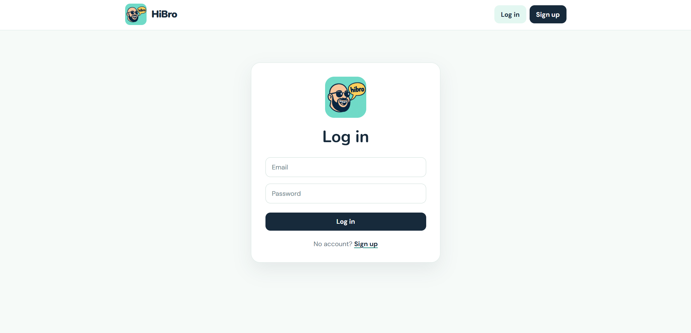

# HiBro Frontend

HiBro is a social media app built for Sigma School Mission 9. This repository contains the React frontend. The [HiBro backend](https://github.com/tehhongjun6-alt/hibro-backend) provides the API and connects to Supabase.

## Screenshot


## Features

- Sign up and log in with email and password
- View public posts and friends-only posts from accepted friends
- Create public or friends-only posts
- Send and accept friend requests
- Responsive layout with HiBro branding

## Run locally

Install the dependencies and start the development server:

```bash
npm install
npm run dev
```

Open the local URL shown in the terminal, usually `http://localhost:5173`.

To check the production build:

```bash
npm run build
```

## Backend connection

The API URL is set in `src/App.jsx`:

```js
const API_URL = 'https://hibro-backend-production.up.railway.app'
```

Change this value if the backend address changes. The frontend uses the API for signup, login, posts, users, and friend requests.

## Pages

| Path | Purpose |
| --- | --- |
| `/signup` | Create an account |
| `/login` | Log in |
| `/feed` | View and create posts |
| `/friends` | Send and accept friend requests |

